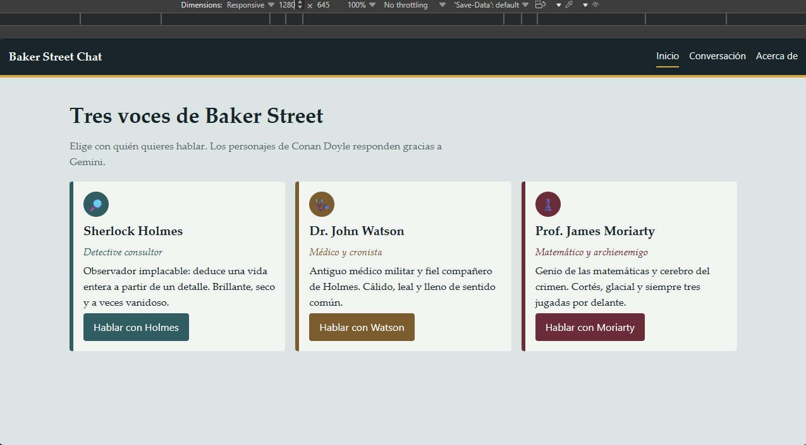

# Baker Street Chat

Aplicación de una sola página (SPA), responsive y _mobile-first_, en JavaScript nativo, para conversar con tres personajes de Conan Doyle. Usa la API de Gemini a través de una función serverless de Vercel.

- **Aplicación desplegada**: _por completar (URL de Vercel)_
- **Capturas de pantalla**: carpeta ...docs/screenshots/



## Personajes

Las novelas de Sherlock Holmes (Arthur Conan Doyle) son de dominio público, por lo que no hay problemas de derechos de autor.

| Personaje            | Papel                       | Tono                                      |
| -------------------- | --------------------------- | ----------------------------------------- |
| Sherlock Holmes      | Detective consultor         | Analítico, directo, vanidoso              |
| Dr. John Watson      | Médico, compañero de Holmes | Cálido, leal, pragmático                  |
| Prof. James Moriarty | Matemático, archienemigo    | Cortés, glacial, amenazante con elegancia |

## Imágenes y logotipo

- `assets/characters/`: retratos de Holmes, Watson y Moriarty (WebP, 640×640), mostrados en las tarjetas de la página de inicio.
- `assets/comicsanscon-logo.svg`: logotipo de «ComicSansCon», agencia digital ficticia usada solo para esta demostración.

## Estructura

```
api/chat.js          Función serverless (llamada a Gemini, clave en el servidor)
src/characters.js    Datos y prompts de los personajes
src/api.js           Obtención de datos (fetch hacia /api/chat)
src/transform.js     Transformación de JSON (contenidos de Gemini, extracción de la respuesta)
src/state.js         Reductores puros
src/router.js        API History: /, /chat/:id, /about
src/views.js         Presentación (HTML puro, con escape)
src/main.js          Conexión de las piezas
styles/main.css      CSS mobile-first (Flexbox, Grid, media queries)
tests/               Pruebas con Vitest
```

## Ejecución en local

Requisitos: Node.js 18+, una cuenta de Vercel, la CLI de Vercel (`npm i -g vercel`) y una clave de la API de Gemini (https://aistudio.google.com/apikey).

```bash
npm install
cp .env.example .env     # y rellenar GEMINI_API_KEY
vercel dev
```

La aplicación queda disponible en http://localhost:3000.

## Almacenamiento de datos

Las conversaciones se guardan únicamente en el navegador de cada persona (`localStorage`), no en un servidor. Al recargar la página se conservan; si se borran los datos del navegador, se pierden. Cada mensaje se envía a la función serverless, que lo reenvía a Gemini.

## Pruebas

```bash
npm test
```

Las pruebas no usan red: `fetch` se simula (`vi.fn`, `vi.stubGlobal`) tanto para el cliente como para la función serverless.

## Despliegue en Vercel

1. Subir el repositorio a GitHub.
2. En vercel.com: **Add New → Project** e importar el repositorio (no requiere _build_; preset «Other»).
3. En **Settings → Environment Variables**, añadir `GEMINI_API_KEY` (y, opcionalmente, `GEMINI_MODEL`) para Production y Preview.
4. Desplegar y verificar: navegación entre las tres secciones, recarga directa en `/chat/holmes`, envío de un mensaje, estado de carga y mensaje de error (por ejemplo, con una clave inválida).

## Uso de la inteligencia artificial

Las imágenes de los 3 personajes fueron generadas a partir de imágenes disponibles en internet pero modificadas para obtener el resultado deseado. Gemini genera las respuestas de los personajes en tiempo de ejecución. Un asistente de IA (Claude) ayudó a producir la estructura inicial del código, las pruebas y esta documentación; el código fue revisado, ejecutado y comprendido por el autor. Las respuestas de los personajes pueden contener errores.
